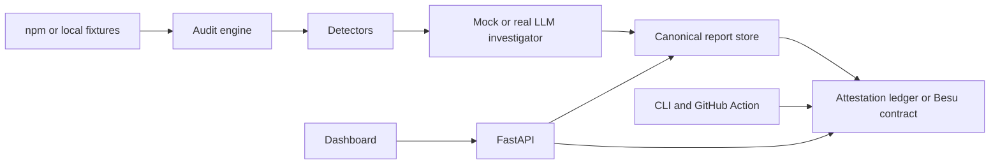

# Architecture

Vouch audits npm package updates before developers install them.

The demo has five layers:

1. The audit engine fetches package contents, compares a version with the previous version, and runs static detectors.
2. The agent layer uses deterministic findings plus a mock LLM provider to produce a verdict, score and cited evidence.
3. The report store writes canonical JSON reports and hashes the exact bytes.
4. The attestation ledger records verdicts by npm integrity hash. The Solidity contract in `contracts/src/VouchRegistry.sol` is the intended on-chain implementation.
5. The CLI, API and dashboard read the same reports and attestations.

The offline demo uses local fixture packages and a JSON ledger. The production path replaces the ledger with Hyperledger Besu and keeps reports off-chain.

